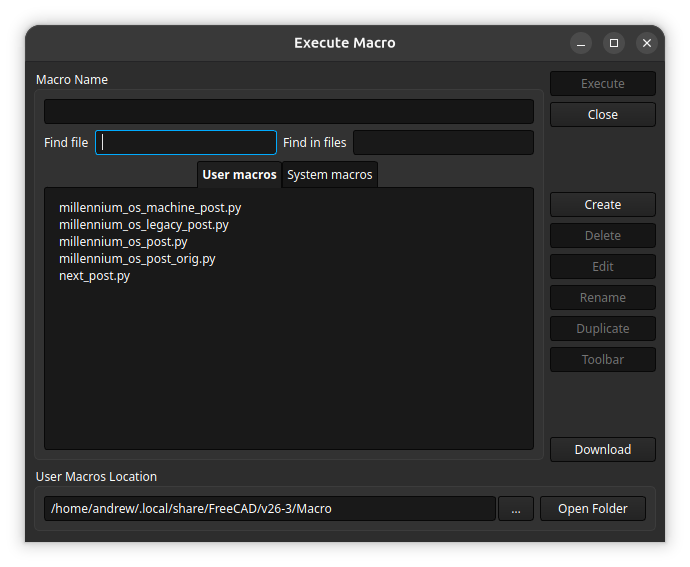

# FreeCAD Post Processors for nxt

Adds a machine-based post for FreeCAD 26.3 and machine definitions for Milo V1.5, V1.6 beta, V2.0, and Miley V2.0. The existing post remains available as the legacy post; both can be installed together and compared on the same job.

The machine post requires a FreeCAD 26.3 weekly build from 2026-09-02 or later. For FreeCAD 1.0 or 1.1, only use the legacy post - the machine-based post pathway is not present in those versions.

Targets the **nxt v0.7.0** line. Implementation details and upstream FreeCAD behavior are in [DEVELOPMENT.md](DEVELOPMENT.md).

## Files

| File | Post name in FreeCAD | Purpose |
|---|---|---|
| `nxt_legacy_post.py` | `nxt-<version>` | the original post, unchanged behaviour |
| `nxt_machine_post.py` | `nxt_machine` | machine-flow port |
| `machines/*.fcm` | — | machine definitions, see below |
| `tools/compare_gcode.py` | — | semantic diff between the two posts' output |
| `tools/post_cli.py` | — | post a job to G-code headlessly, without the GUI |

### Included machine definitions

| File | Machine name | Travels (X/Y/Z) | Rapids (X/Y/Z) |
|---|---|---|---|
| `machines/Milo_V1.5.fcm` | Milo V1.5 | 340 / 160 / 120 | 2000 / 2000 / 1000 |
| `machines/Milo_V1.6.fcm` | Milo V1.6 beta | 300 / 160 / 120 | 2000 / 2000 / 1000 |
| `machines/Milo_V2.0.fcm` | Milo V2.0 | 348 / 210 / 120 | 2000 / 2000 / 1000 |
| `machines/Miley_V2.0.fcm` | Miley V2.0 | 308 / 210 / 120 | 2000 / 2000 / 1000 |
| `machines/Milo_V1.5_Rotary.fcm` | Milo V1.5 + Rotary | 340 / 160 / 120 | 2000 / 2000 / 1000 |
| `machines/Milo_V1.6_Rotary.fcm` | Milo V1.6 beta + Rotary | 300 / 160 / 120 | 2000 / 2000 / 1000 |
| `machines/Milo_V2.0_Rotary.fcm` | Milo V2.0 + Rotary | 348 / 210 / 120 | 2000 / 2000 / 1000 |

**Every number in these files is a nominal starting point, not a measurement.** Travels are the published figures, quoted minus endstop; your `M208` soft limits will sit a few mm inside them and hard limits may vary based on your build. Rapids are the published V1.5 figures, used for all four because no rapid speed is published for V2 — yours will depend on motors, drive voltage and whether you fitted leadscrews or ballscrews. The stock LDO spindle is described as 1.5 kW running 7200–24000 rpm, but this is just one common configuration among many. You will need to adjust these for your machine!

There is deliberately **one definition per machine rather than one per possible configuration** (with the exception of the Spit Roast configs described below). Power, rpm range, cooling, motors and drive voltage all vary between builds, and no useful number of shipped variants would cover that. Copy the definition matching your machine and edit it to fit — see the next section.

### The Spit Roast definitions

The `_Rotary` variants add an **A axis about X** for the Spit Roast 4th axis. They are
separate files rather than an option on the existing ones, because the FreeCAD base class emits a
rotary positioning move for every pose change as soon as a rotary axis exists in the machine def — adding A
to the shipped definitions would change the G-code every existing 3-axis user gets.

A-axis figures come from the MosFourthAxis plugin's `rotary-plugin-config.g` and are
nominal in the same way as everything else here:

| | Value | From |
|---|---|---|
| Limits | ±3600° | `M208 A-3600 / A3600` |
| Max velocity | 45000 °/min | `M203 A45000` |
| Acceleration | 300 °/s² | `M201 A300` (not carried into the `.fcm`) |
| Steps/degree | 177.7919 | `M92 A177.7919` |

`kinematics.rotation_strategy` is `dwo`. That is the only strategy the base class can
actually emit for a control with no tilted-work-plane command, and what it emits is a
plain `G0 A<angle>` with the path already rotated into the machine frame — exactly what
the Fusion post does. RRF has no `G68.2`, so `twp` is not an option, and `post_transform`
is declared upstream but unimplemented. (Note RRF's `G68` is a 2D rotation about Z, used
for tramming compensation — not a tilted work plane.)

`pre_rotary_move` is `G53 G0 Z0`, so Z retracts to machine zero before any rotation. **No
X retract is set.** The Fusion post defaults its X retract to disabled too, and a safe X
is a per-setup value you have to verify against your own fixture; its reference figure is
X=54 on a V1.5. Add it to `pre_rotary_move` if you want it.

**Three limitations worth knowing before you cut:**

- **Indexed (3+1) only.** Continuous 4-axis needs inverse-time feed (`G93`). RRF has
  supported `G93` since 3.5, and FreeCAD has a continuous op (`Path/Op/RotarySurface.py`),
  but FreeCAD's post pipeline never emits `G93` — `GCODE_FEED_INVERSE_TIME` exists only in
  its modal-command lists. A continuous path would come out with a units-per-minute feed
  on a move that is mostly rotation.
- **Work zero must sit on the rotary centreline.** Nothing applies a pivot offset, so
  rotation only leaves the WCS valid if the origin is on the axis of rotation. Probe it
  with `M4910`.
- **Untested on hardware.** No posted rotary job has been cut. Dry-run above the work.

**V1.6 is beta.** Its travels and rapids are inherited from V1.5. The XY and Z plates and anti-backlash block are new compared to V1.5 and change the workarea, so verify the limits against your machine's `M208` before use.

---

## Check these against your machine

A `.fcm` is plain JSON and can be edited in a text editor or through the CAM Machine editor in FreeCAD (under Preferences → CAM → Assets). Either way FreeCAD re-reads the file on every post, so changes take effect on the next job with no restart. There is also a validator in the machine editor that checks for common errors.

### These change the G-code

Get these right before cutting.

| Field | Where it comes from | What goes wrong if it is off |
|---|---|---|
| `machine.toolheads[0].min_rpm` | spindle rating / VFD parameters | FreeCAD's `Path/Tool/FeedsSpeeds/resolver.py` clamps any calculated speed up to this floor **and scales feeds by the same ratio** to hold chipload. A floor set too high silently raises your feeds; too low lets the spindle run where it has neither cooling nor torque |
| `machine.toolheads[0].max_rpm` | as above | speeds above it are clamped down, again rescaling feeds |
| `postprocessor.properties.nxt_version` | the nxt version in firmware | `M4005` fails and the job will not run |

The shipped floor of 7200 rpm assumes an **air-cooled** spindle, where the shaft fan gives least airflow exactly when torque demand is highest. A water-cooled spindle has no such constraint and can usually take a considerably lower floor — 6000 or below. If you have changed spindle, this is the first field to revisit. **Always check your values here; these are generic common limits in the provided files, but your mileage may vary and getting this wrong can damage your spindle!**

### These should be accurate but do not affect output today

On 3-axis machines, these values do not affect posted G-code. The validator still checks axis limits and reports ignored keys, so keep the values accurate for the Machine editor and future FreeCAD versions.

| Field | Where it comes from |
|---|---|
| `machine.axes.X/Y/Z.limits.min` and `.max` | RRF `M208` — your configured soft limits, usually a few mm inside nominal travel |
| `machine.axes.X/Y/Z.max_velocity` | RRF `M203` — varies with motors, drive voltage and leadscrew versus ballscrew, so two nominally identical machines can differ |
| `machine.toolheads[0].max_power_kw` | spindle manufacturer's docs |
| `machine.toolheads[0].coolant_mist` / `coolant_flood` | whether you run air blast, mist or flood (note: air as a distinct cooling mode is not currently supported in FreeCAD machine posts) |

> **Note**: `limits.min` must be strictly less than `limits.max` or the definition fails validation.

To read the firmware values, send `M208` and `M203` with no parameters in the nxt console. `M203` takes and reports mm/min, which is what the `.fcm` wants — but the object model (`M409 K"move.axes[0]"`) reports `speed` in mm/s, so multiply by 60 if you read it that way. Also check whether your `config.g` pulls in sub-files with `M98 P"..."`; the values you want may not be in the main file.

### Workflow preferences, not machine facts

These sit in `postprocessor.properties` and are yours to set: `probe_mode` (`AT_START`, `ON_CHANGE`, `NONE`), `home_before_start`, `vssc` with `vssc_period` and `vssc_variance`, `output_tools`, `output_job_setup`, and `allow_zero_rpm`. The shipped values are `ON_CHANGE` probing, homing on, VSSC on at 4000 ms / 200 rpm. Change these to match your needs!

One field is deliberately zero and worth understanding before changing: `toolheads[0].toolhead_wait` is `0.0` because this post emits `M3.9`, which already blocks until the spindle reaches speed. Setting it non-zero adds a `G4` dwell on top, so you would wait twice. Raise it only if your spindle genuinely does not reach speed by the time `M3.9` returns (if you have run the nxt config wizard, this should not be the case).

### Leave these alone unless you know why

The `output.*` and `processing.*` settings were arrived at by diffing output against the legacy post, and several break the G-code if reverted — `duplicates.commands` strips the command word off `M4000` lines, and `filter_inefficient_moves` deletes rapids whenever upstream wires it back up. The reason for each is in [DEVELOPMENT.md](DEVELOPMENT.md#machine-definition-settings).

---

## Installing the legacy post

1. Download `nxt-<version>_post.py` from the [GitHub Release](https://github.com/MillenniumMachines/MOS-nxt/releases) on the same **major.minor** line as installed nxt (e.g. any 0.7.x post with 0.7 firmware; `M4005` ignores beta/rc/patch).
2. Copy it into your FreeCAD **macro directory** (the same folder used for `.FCMacro` files).
3. Restart FreeCAD or refresh the CAM post list if needed.
4. In the CAM workbench, select the post processor whose name matches the file prefix (e.g. `nxt-v0.7.0` for `nxt-v0.7.0_post.py`).

FreeCAD expects post processors to follow the `<prefix>_post.py` naming convention (`_post.py` must be lowercase). See the [FreeCAD CAM post customization guide](https://github.com/FreeCAD/FreeCAD-documentation/blob/main/wiki/CAM_Postprocessor_Customization.md#naming-convention).

## Installing the machine post

1. **Post processor** → copy `nxt_machine_post.py` onto FreeCAD's post search path; the macro directory is the usual choice (on Linux, `~/.local/share/FreeCAD/v<version>/Macro/`). You can also find it by opening the FreeCAD Macros dialog (menu Macro → Macros); the path is shown as User Macros Location at the bottom of the dialog:

   

   **Do not rename this file.** `PostProcessorFactory.get_post_processor()` resolves the class as the filename minus `_post.py`, title-cased — `nxt_machine` → `Nxt_Machine`. A versioned filename would not be a valid identifier, the factory would silently fall back to `WrapperPost`, and posting fails with *"The script does not have an 'export' function"*. This is why the release ships it unversioned while the legacy post keeps its `nxt-<version>_post.py` name.

   The search order is FreeCAD's `defaultFilePath()`, then `macroFilePath()`, then addon post directories, then FreeCAD's own `Path/Post/scripts/`. **The first match wins**, so an older copy in the CAM default file path can silently shadow the one you just installed. To check which file actually loads, run this in FreeCAD's Python console:

   ```python
   import os, Path.Preferences as PP
   print("\n".join(("WINS " if os.path.exists(os.path.join(p, "nxt_machine_post.py")) else "  -  ")
                   + os.path.join(p, "nxt_machine_post.py") for p in PP.searchPathsPost()))
   ```

2. **Machine definitions** → copy the `.fcm` files into `<CAM asset path>/Machines/`. Check the values against your own machine first — see "Check these against your machine". The default asset path is `FreeCAD.getUserAppDataDir()/CamAssets`; check yours with `Path.Preferences.getAssetPath()`.

   > **Note**: this path can also be configured. If you can, create a repo for your CAM assets and point FreeCAD at it — that version-controls not just the machine definitions but any FreeCAD tool bits you have set up, which is especially worth doing if you work on multiple computers.

3. **Restart FreeCAD.** Confirm the post is classified correctly (Python console):

   ```python
   import Path.Preferences as P
   P.classifyPostProcessor("nxt_machine")   # -> 'machine'
   ```

   If it reports `unknown`, the module raised on import and the classifier swallowed the traceback. The 26.3 machine post API is a moving target, so FreeCAD changes during its development cycle can break this.

4. **In the CAM Job**, set Machine to the entry matching your machine, e.g. `Miley V2.0`. The postprocessor comes from the machine definition, not from the job. It can be set in the Job settings panel on the General tab, or in the job properties view.

5. **Check `nxt_version`** in the machine definition matches your firmware line. The machine post reads it from there, not from `RELEASE.VERSION`. Since v0.7.0, `M4005` compares **major.minor only** (`macros/utilities/M4005.g`), so the shipped `v0.7.0` value covers `v0.7.0-beta.N`, `v0.7.0-rcN` and `v0.7.x` firmware without re-exporting — but crossing a line (0.6 → 0.7) still aborts. The post refuses to post at all if the value is still the `%%NXT_VERSION%%` build placeholder, rather than emitting a bad `M4005`.

---

## nxt-specific divergence from the MillenniumOS post

This post tracks `millennium_os_machine_post.py` in the MillenniumOS repo so the two stay diffable. On the v0.7.0 line there is exactly **one** behavioural divergence.

| Feature | Code | Status in nxt | Handling |
|---|---|---|---|
| Canned-cycle modals | `G80` / `G98` / `G99` | **implemented** (`macros/canned/`), unlike RRF/MillenniumOS | still dropped, for parity with `nxt_legacy_post.py`, which carries `_UNSUPPORTED = [98, 99]` and never emits G80 |

nxt's `G80.g` / `G98.g` / `G99.g` maintain real modal state (`global.nxtCannedCycle`, `global.nxtCannedRetractMode`), so emitting them may well be correct — but it is a behaviour change from what nxt users get today, and it needs validating against a drilling job on real hardware first. See `UNSUPPORTED_MODAL` in `nxt_machine_post.py`.

> **Earlier v0.6.0 divergences, now resolved.** The v0.6.0 port defaulted VSSC off and added a `rotation_compensation` property, because that line shipped no `M7000`/`M7001`/`M5011`. The v0.7.0 line implements all three (`macros/spindle/M7000.g`, `M7001.g`, `nxt-run-vssc.g`, `macros/utilities/M5011.g`), so both special cases are gone and the post matches MillenniumOS again.

> **Still absent on v0.7.0:** `M3000`. The legacy post's `oncomment()` emits `M3000 R"FreeCAD" S"..."` for an operation Comment, which has no macro and will abort. The machine post emits nothing for comments. Pre-existing, untouched by this port.

---

## Parity with the legacy post's v0.7.0 fixes

Both fixes the legacy post gained on this line are carried here:

- **Explicit G1 to arc start after a plane change** (upstream `32d18b0`). RRF takes an arc's start point from the live machine pose rather than from the command, so after a plane change a modal axis word suppressed as unchanged can leave an out-of-plane axis stale and the arc starts from the wrong point. Implemented in `_force_arc_start_after_plane_change()`, porting legacy's `onplane()` / `_forceArcStartPose()` pair: X and Y are restated, never Z, once per plane change.

  **X/Y-only is a deliberate match to the legacy FreeCAD post, and it differs from the Fusion post.** `nxt.cps` restates the two *in-plane* axes — X/Y for `G17`, X/Z for `G18`, Y/Z for `G19`. Both FreeCAD posts restate X/Y whatever the plane, which covers a `G18`→`G17` transition but leaves Z unstated when entering an `XZ` arc. See "Not yet covered".

  **The restatement has to survive two separate suppression passes, and that is most of its design.** It restates the pose the machine is already at, so anything that strips unchanged axis words reduces it to a bare `G1`, which the base then drops as a move with no parameters — the exact silent failure it exists to prevent.

  - `modal_axis()` strips duplicate axis words at the Path.Command stage, in `_optimize_duplicates_doubles()`. Handled by injecting *after* that pass: this post overrides `_optimize_duplicates_doubles()`, calls `super()` first and injects second, so the deduplicator never sees the injected moves. Pose is accumulated rather than read per command, because by then a command carries an axis word only when that axis changed.
  - `_convert_move()` strips them again at conversion, comparing against `machine_state.previous`. Handled in `_convert_linear_move()`: the injected move carries an annotation, and for that command only, the two axis entries in `previous` are blanked for the duration of the call and restored afterwards.

  If you refactor either method, keep that split. An injected move that reaches `modal_axis()`, or that converts without the bypass, comes out as a bare `G1` and silently does nothing.
- **4-decimal axis output** (upstream `42cc6d0`, `AXIS_DECIMALS = 4`, "to satisfy RRF G2/G3 arc tolerance"). Handled via `output.precision.axis: 4` in every shipped machine definition — `dist/verify-post-processor-naming.sh` asserts it, since reverting to 3 reintroduces the defect.

---

## Posting from the command line

`tools/post_cli.py` posts CAM jobs without opening the GUI. It finds a FreeCAD console binary and re-executes itself under FreeCAD.

```sh
# what is in the file
tools/post_cli.py --list job.FCStd

# post using the working tree: this repo's post module and this repo's .fcm
tools/post_cli.py job.FCStd -M machines/Milo_V1.6.fcm -o out.gcode

# the legacy post, for comparison runs
tools/post_cli.py job.FCStd -p nxt_legacy -o legacy.gcode
```

Two things make this useful for testing rather than just convenient:

- **`--post-dir`** is prepended to FreeCAD's post search path, and defaults to
  this repo. `searchPathsPost()` normally puts the user Macro directory first,
  so without this a run would silently exercise whatever was last synced there
  instead of the working tree.
- **`-M/--machine-file`** loads a `.fcm` straight off disk and injects it into
  the processor, bypassing the CAM asset store. Together with `--post-dir` a
  run touches no installed copy of either half of the post.

Jobs are recomputed before posting, so toolpaths are regenerated rather than
read from whatever was cached in the document.

### Choosing which job to post

A document with several jobs posts all of them unless told otherwise. `-j`
takes the job **label** — what the CAM tree shows — and is repeatable:

```sh
# both jobs -> bookmark_Top.gcode and bookmark_Bottom.gcode
tools/post_cli.py bookmark.FCStd -M machines/Milo_V1.6.fcm -o bookmark.gcode

# just one, written to exactly the name given
tools/post_cli.py bookmark.FCStd -j Top -M machines/Milo_V1.6.fcm -o top.gcode
```

The output name is only decorated when one run produces more than one file, so
a single `-j` gives you exactly the `-o` path. The internal object name (`Job`,
`Job001`) is also accepted, which is how you disambiguate duplicate labels. An
unmatched `-j` lists the labels that do exist and exits non-zero, as does any
other failure.

FreeCAD is located in this order: `$FREECADCMD`, the newest weekly AppImage in
`~/Downloads`, then `freecadcmd` on `PATH`. Make sure the selected build meets
the requirement above; stable FreeCAD 1.1 lacks the `Machine` module.

---

## Verifying against the legacy post

Post the same job through both, then:

```sh
tools/compare_gcode.py legacy.gcode machine.gcode
```

The comparison tool ignores formatting differences and compares commands and numeric values. A clean result establishes equivalence for that job only, not hardware safety. Known differences and coverage gaps are in [DEVELOPMENT.md](DEVELOPMENT.md#validation-notes).

---

## Before you cut

After a tool change, the post moves to XY while still at park height, then descends to clearance to avoid traversing through the toolsetter. The MillenniumOS port this tracks has been tested on over a dozen jobs there, but **nothing here has been run against nxt firmware**. **Dry-run your first job above the workpiece and verify clearance.**
